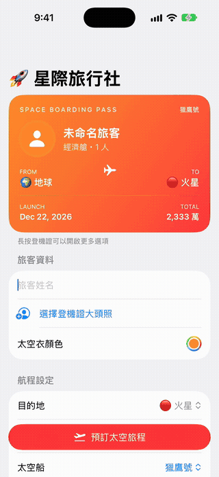
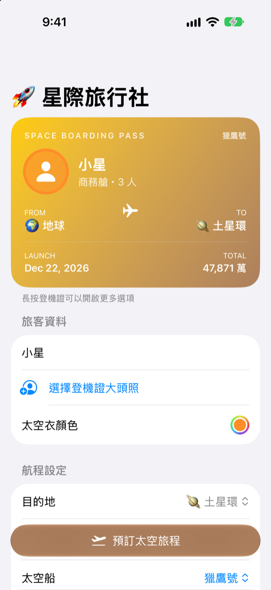
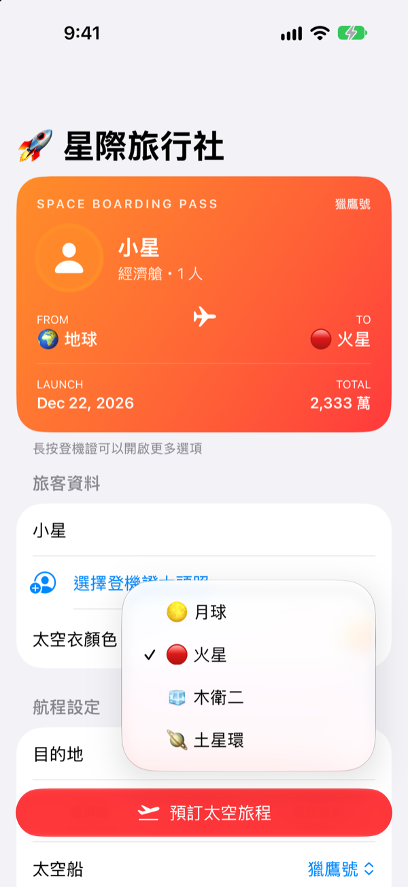
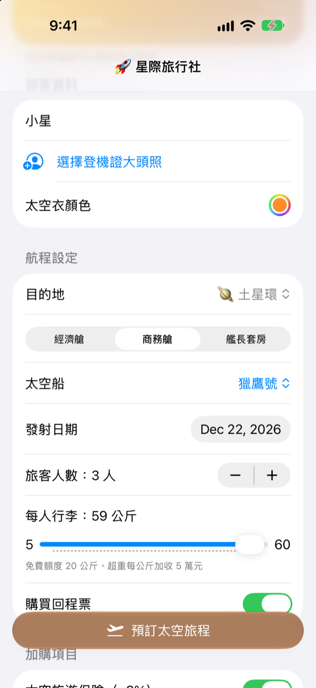
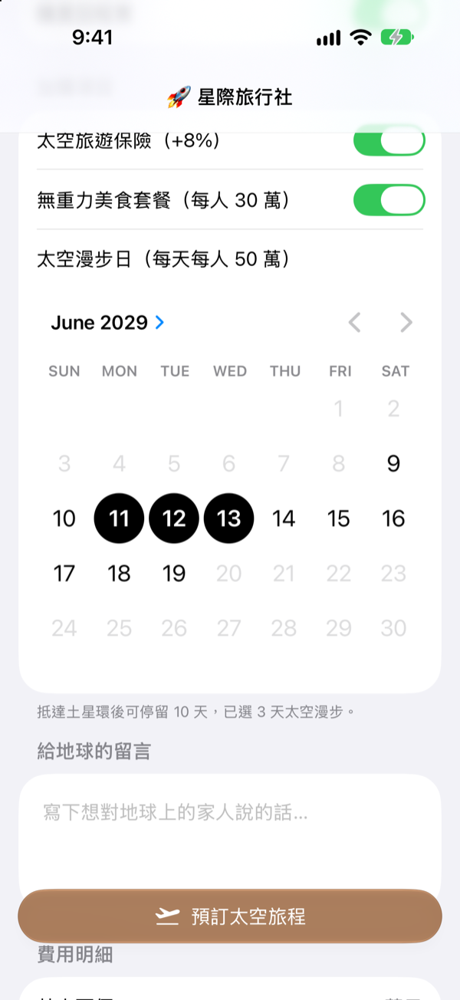
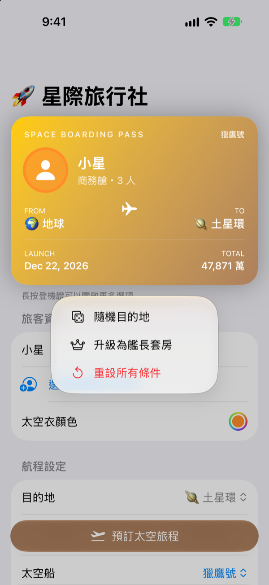
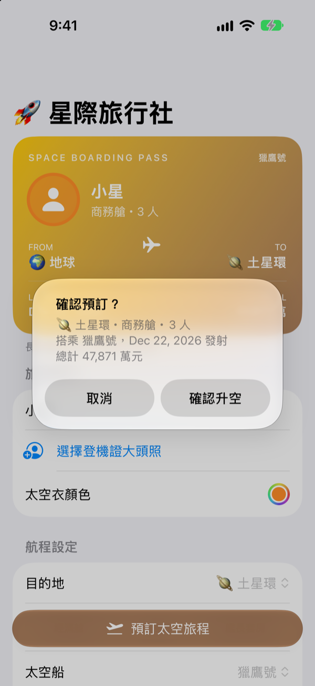
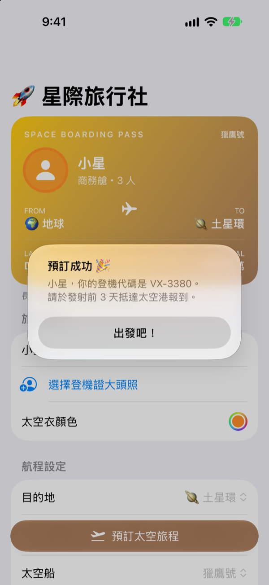

# 🚀 星際旅行社 Space Voyage Planner

用 SwiftUI 製作的太空旅程預訂 App。填寫旅客資料、選目的地、艙等、發射日期和加購項目，畫面上方的**太空登機證**會跟著即時更新，下方會算出詳細費用。按下「預訂太空旅程」後，App 會用 alert 確認訂單並給你一組登機代碼。

## 操作畫面

## App 截圖

| 登機證 | 目的地選單 | 航程設定 |
| --- | --- | --- |
|  |  |  |

| 加購項目／太空漫步日 | 長按選單 contextMenu |
| --- | --- |
|  |  |

| 確認預訂 alert | 預訂成功 alert |
| --- | --- |
|  |  |

## 使用到的 SwiftUI 元件

| 元件 | 用途 |
| --- | --- |
| `TextField` | 輸入旅客姓名 |
| `PhotosPicker` | 選一張照片當登機證大頭照 |
| `ColorPicker` | 選太空衣顏色（大頭照外框） |
| `Picker`（menu） | 選目的地：月球、火星、木衛二、土星環 |
| `Picker`（segmented） | 選艙等：經濟艙、商務艙、艦長套房 |
| `Picker`（menu） | 選太空船 |
| `DatePicker` | 選發射日期 |
| `MultiDatePicker` | 在抵達後的停留期間挑選太空漫步日 |
| `Stepper` | 調整旅客人數（1～8 人） |
| `Slider` | 調整每人行李重量（5～60 公斤） |
| `Toggle` | 回程票、旅遊保險、無重力美食套餐 |
| `TextEditor` | 寫給地球的留言 |
| `contextMenu` | 長按登機證：隨機目的地／升級艦長套房／重設所有條件 |
| `alert` | 缺少姓名提醒、確認預訂、預訂成功 |

## 費用怎麼算

- **基本票價** = 目的地票價 × 艙等倍率 × 人數（買回程票再 × 1.8）
  - 目的地：月球 300 萬、火星 1,200 萬、木衛二 3,500 萬、土星環 5,000 萬
  - 艙等倍率：經濟艙 1.0、商務艙 1.6、艦長套房 2.5
- **行李超重**：免費 20 公斤，超過的部分每公斤每人 5 萬
- **無重力美食套餐**：每人 30 萬
- **太空漫步**：每天每人 50 萬
- **旅遊保險**：以上小計的 8%

App 也會依目的地的航行天數，推算出可以安排太空漫步的日期和預計返回地球的日期。

## 開發環境

- Xcode 27 / iOS 27
- SwiftUI
